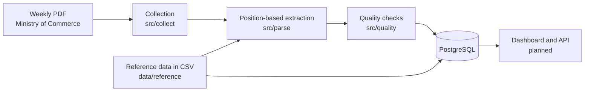

# Côte d'Ivoire Price Observatory

An automated data pipeline that collects the consumption prices published weekly by Côte d'Ivoire's
Ministry of Commerce, cleans and validates them, and stores them in PostgreSQL by product, region and week.

**Status:** daily automated collection (GitHub Actions) · 49 weeks loaded (May 2025 → June 2026).

## Architecture



## Design decisions

- **Position-based extraction, not text-based.** When a product was not surveyed in a region, its cell is
  simply absent from the PDF; reading the text line by line would shift values into the wrong region.
  Each number is attached to its column from its horizontal position.
- **Idempotent.** A file is identified by its SHA-256 hash, so re-running the pipeline never creates duplicates.
- **Atomic and traceable.** A week is loaded entirely or not at all, and every attempt (success, failure,
  skipped) is recorded in `ingestion_run` together with the reason.
- **Anomalies are flagged, never silently corrected** (`quality_flag`). A real example: a maximum of
  40,000 FCFA/kg for beef whose neighbouring prices are around 4,000.
- **Reference data lives in Git.** 14 districts, 31 regions (plus 2 autonomous districts), 111 departments
  and the tracked products are kept in `data/reference/*.csv`; adding a region means adding one line,
  with no code change.
- **When in doubt, refuse.** An unknown or ambiguous region header, an unknown product, or too few regions
  causes the week to be rejected with the reason, and the daily job fails so that the maintainer is alerted.

## Getting started

```bash
python -m venv .venv && source .venv/bin/activate      # Windows: .venv\Scripts\activate
pip install -r requirements-dev.txt
cp .env.example .env                                   # set DATABASE_URL
python -m src.admin setup                              # migrations + reference data
python -m src.pipeline --from 2025-05-05 --to 2026-06-01   # backfill history
python -m src.pipeline --weeks-back 3                  # daily mode
python -m pytest -q                                    # set TEST_DATABASE_URL to run the database tests
```

## Known limitations

- 8 of the 57 weeks between May 2025 and June 2026 could not be found at the public addresses queried;
  there is no data before May 2025.
- Prices are min / max / average **per region**, already aggregated by the source, so no weighted
  average is possible.
- The PDF covers only 24 of the 33 zones and contains no packaged goods such as oil or sugar.

## Next steps

Indicators (weekly change, regional gaps), a public dashboard, a complementary market-level source,
and a comparison with the official price ceilings.
